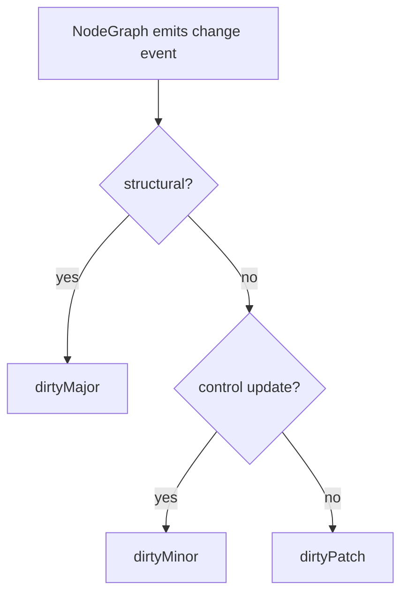

# Collection Version Bump Policy

## Overview

Each `Collection` carries a semantic version (`major.minor.patch`) plus three dirty flags (`dirtyMajor`, `dirtyMinor`, `dirtyPatch`). The version number itself is **never incremented during normal editing or saving**. Instead, dirty flags are set immediately when changes occur and the version is only bumped at well-defined "publish" moments.

---

## Dirty Flags

Dirty flags are set by `Collection.#graphChanged()` whenever a `NodeGraph` emits a change event. The flag chosen depends on the kind of change:

| Change kind | Flag set |
|---|---|
| Node/connection added or removed (structural) | `dirtyMajor` |
| Control value changed | `dirtyMinor` |
| Node position / viewport moved | `dirtyPatch` |
| Graph reordered (`Collection.moveGraph()`, `Collection.GraphMoved.v1`) | `dirtyMajor` |
| Graph settings/metadata changed (`executionType`, `interval`, `enabled`, `color`, `name`) | `dirtyPatch` |

The rule is applied by the `else` branch of `Collection.#graphChanged()`: every graph event that is
not structural or a control update counts as a patch-level change, which is why toggling a graph's
`enabled` flag (event `enabled`, payload `NodeGraph.EnabledChanged.v1`) marks the collection
`dirtyPatch`.

**Graph reordering** does not flow through `#graphChanged()`; `Collection.moveGraph()` calls
`markMajorVersionDirty()` directly because the persisted `graphs` array order changes. It is treated
exactly like graph add/remove: a publish/export will therefore bump the major version.



> **Note:** the graph `enabled` event is deliberately **not** recorded by `HistoryManager`, exactly
> like `color` (see [undo-redo-architecture.md](./undo-redo-architecture.md)). Toggling a graph off is
> therefore not undoable; use the checkbox to toggle it back.

Flags accumulate — once set they remain until the version is bumped. Multiple changes between two bump points collapse into a single version increment.

The dirty state is **persisted to IndexedDB** with every save so it survives a browser reload.

---

## When the Version Is Bumped

The version is bumped (and all dirty flags cleared) **only** at the following four points:

### 1. Collection load

When a collection is read from IndexedDB — either via `CollectionManager.loadCollection()` or `CollectionManager.loadCollections()` — the loader calls `collection.bumpVersionIfDirty()` immediately after deserialization, then saves the bumped version back to IndexedDB.

**Why here?** The user closed the app with unsaved dirty flags. On the next session the version should reflect those accumulated changes before the collection is used for anything.

**Implementation:** `CollectionManager.loadCollection()` and `CollectionManager.loadCollections()` in [collection-manager.ts](../../../src/micro_otter/nodes/html/js/data/collection-manager.ts).

### 2. Before export (single collection)

When the user exports the active collection to a JSON file via *Download JSON*, `_handleExportCollection()` calls `bumpVersionIfDirty()` and saves before serializing. The exported file therefore always carries the final bumped version.

**Implementation:** `WorkspaceView._handleExportCollection()` in [workspace-view.ts](../../../src/micro_otter/nodes/html/js/views/workspace-view.ts).

### 3. Before backup (all collections)

When the user exports the full database backup, `_handleBackupDB()` calls `bumpVersionIfDirty()` and saves for **each** collection before serializing it into the backup JSON.

**Implementation:** `WorkspaceView._handleBackupDB()` in [workspace-view.ts](../../../src/micro_otter/nodes/html/js/views/workspace-view.ts).

### 4. Before transpilation / deployment

When a collection is transpiled (to preview generated code or to deploy to a device), `CollectionManager.transpileCollection()` calls `bumpVersionIfDirty()` and saves the bumped version before passing the collection to the transpiler.

**Implementation:** `CollectionManager.transpileCollection()` in [collection-manager.ts](../../../src/micro_otter/nodes/html/js/data/collection-manager.ts).

---

## What Does NOT Bump the Version

| Action | Why not |
|---|---|
| Editing a node graph (adding nodes, moving nodes, changing controls) | Should only mark dirty so multiple edits accumulate |
| `CollectionStore.saveCollection()` | Pure persistence — saves whatever state the collection is currently in, including dirty flags |
| `Collection` constructor / deserialization | Bump happens in the **caller** (the load methods), not during construction |
| `Workspace.saveActiveCollection()` / `Workspace.saveCollection()` | These are persistence helpers — bump must be explicit at the call site |

### Additive graph fields do not need a schema bump

`NodeGraph.toData()` gained an optional `documentationAreas` array. This is an **additive,
optional** graph field:

- a document written by an older build simply has no key, and `NodeGraph.fromData()` treats a
  missing, `null` or non-array value as an empty list;
- a document written by a newer build and read by an older one is unaffected, because every reader
  ignores keys it does not know;
- no migration runs, so no schema version is required and nothing forces a version bump beyond the
  normal dirty-flag path (adding, editing, moving or deleting a documentation area marks the
  collection dirty like any other graph edit).

The same reasoning covers additive *fields inside* an existing optional structure: the area's
`contentAlign` (`'top' | 'bottom'`) and `fontSize` (`'small' | 'normal' | 'large'`) arrived after
`documentationAreas` did. `DocumentationArea`'s constructor normalizes a missing or unknown value to
the `'top'` / `'normal'` default, so an entry written by an older build loads unchanged and an older
build reading a newer document simply ignores the keys.

Any future change that *removes* or *reinterprets* an existing field is a different matter and does
need a version bump.

---

## `bumpVersionIfDirty()` Semantics

`Collection.bumpVersionIfDirty()` (defined on the `FlaggedVersion` value object) applies the highest-priority dirty flag:

1. If `dirtyMajor` → `major += 1`, reset `minor = 0`, `patch = 0`, clear all flags.
2. Else if `dirtyMinor` → `minor += 1`, reset `patch = 0`, clear `dirtyMinor` and `dirtyPatch`.
3. Else if `dirtyPatch` → `patch += 1`, clear `dirtyPatch`.
4. If no flags are set → version is unchanged (no-op).

The method returns `true` if a bump occurred, `false` otherwise, so callers can decide whether an additional save is needed.

---

## Correct Call Pattern

Wherever a bump is required before an operation, always follow this pattern:

```ts
const wasBumped = collection.bumpVersionIfDirty();
if (wasBumped) {
    await collectionManager.saveCollection(collection);
}
// ... proceed with export / transpile / etc.
```

Do **not** call `bumpVersionIfDirty()` inside general-purpose save or serialization helpers — keep bump logic at the explicit publish call sites listed above.

---

## Related Files

| File | Role |
|---|---|
| [data/collection.ts](../../../src/micro_otter/nodes/html/js/data/collection.ts) | `bumpVersionIfDirty()`, dirty flag propagation from graph events |
| [data/flagged-version.ts](../../../src/micro_otter/nodes/html/js/data/flagged-version.ts) | `FlaggedVersion` value object: stores version + dirty flags, implements bump logic |
| [data/collection-store.ts](../../../src/micro_otter/nodes/html/js/data/collection-store.ts) | Pure persistence — no bump logic |
| [data/collection-manager.ts](../../../src/micro_otter/nodes/html/js/data/collection-manager.ts) | Bump on load; bump before transpile |
| [views/workspace-view.ts](../../../src/micro_otter/nodes/html/js/views/workspace-view.ts) | Bump before export and before backup |
